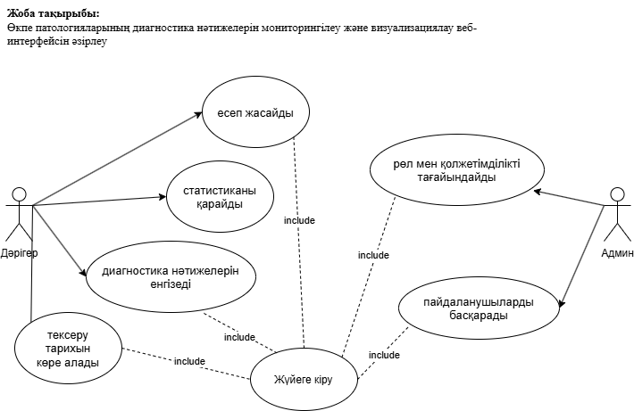
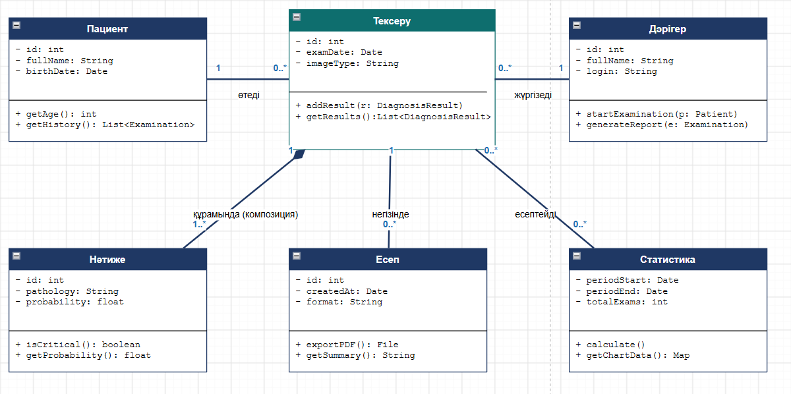
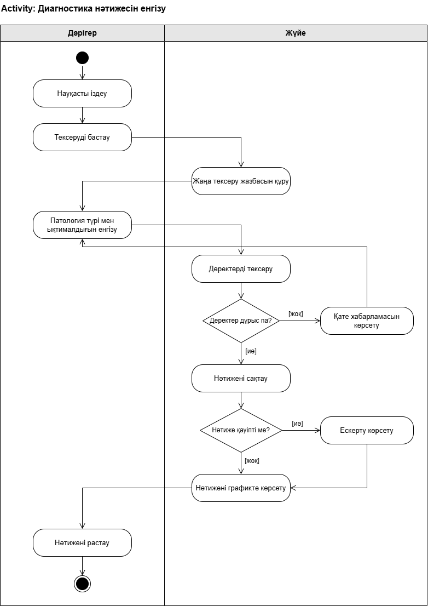
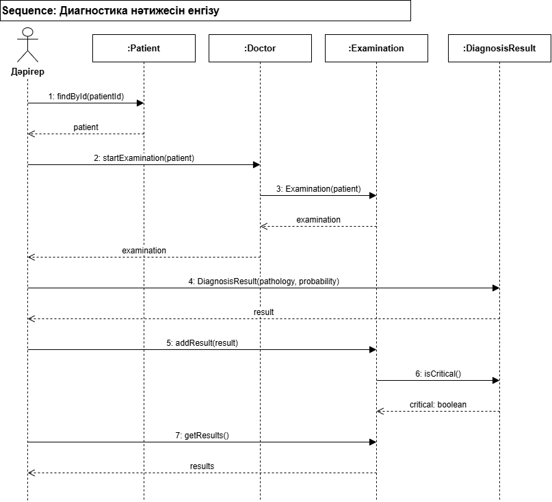

# Өкпе патологияларының диагностика нәтижелерін мониторингілеу және визуализациялау веб-интерфейсін әзірлеу

Автор: Рахымжан Мустафин, ВТ(КИ)к-24-1б

## Мәселе

Дәрігерлер өкпе тексерулерінің диагностика нәтижелерін әртүрлі жүйелерде қарайды, бұл уақытты алады және қателік қаупін арттырады. Жүйе диагностика нәтижелерін бір веб-интерфейсте жинап, оларды графиктер мен статистика түрінде көрсетеді. Ол рентгенолог және пульмонолог дәрігерлерге арналған.

## Акторлар

- Дәрігер

- Әкімші

## Талаптар

### Функционалдық

1. Жүйе дәрігерге диагностика нәтижесін (патология түрі, ықтималдығы) көрсетуі керек.

2. Жүйе науқастың тексеру тарихын күні бойынша көрсетуі керек.

3. Жүйе тексеру нәтижелерін графиктер түрінде визуализациялауы керек.

4. Жүйе таңдалған кезең бойынша статистиканы (тексеру саны, патология түрлері) есептеуі керек.

5. Жүйе дәрігерге тексеру нәтижесі бойынша PDF есебін құруға мүмкіндік беруі керек.

6. Жүйе тексеру тарихын науқастың аты немесе күні бойынша іздеуге мүмкіндік беруі керек.

7. Жүйе әкімшіге пайдаланушыны қосуға және оған рөл тағайындауға мүмкіндік беруі керек.

### Функционалдық емес

1. Дашборд беті 3 секундтан кем ашылуы керек.

2. Жүйеге кіру логин мен пароль арқылы жүруі керек; науқас деректері тек рөлі бар пайдаланушыға көрінеді.

3. PDF есебі 10 секундтан аспай құрылуы керек.

## Диаграммалар

### 1. Use Case

### 2. Class

### 3. Activity: Диагностика нәтижесін енгізу

### 4. Sequence: Диагностика нәтижесін енгізу

